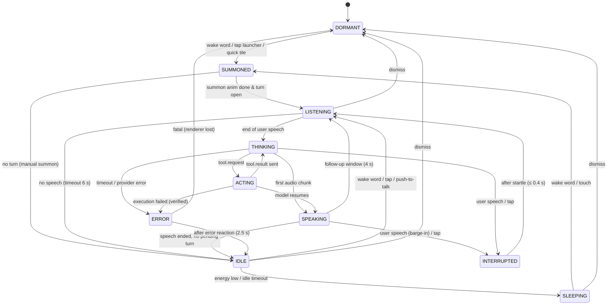

# 04 — Animation & Autonomy Specification

Visuals: **VB-04** rig & animation, **VB-05** behaviour engine, **VB-06** state machine. Clip names are the 48 verified names (doc 02 §1.4). Numeric tuning values below are *initial defaults* to be tuned visually in M1; they are not claims about the asset.

## 1. Principle: clips are primitives, not the vocabulary

The 48 authored clips are **full-body takes** (F4) with baked float, blinks and gaze (F5). The runtime therefore treats a clip as *a source of curves* that can be (a) played whole, (b) played through a **joint mask** and **channel-group mask**, (c) sampled at one time to yield a **pose**, or (d) ignored for some channels. On top sit procedural layers (look-at, blink, speech visemes, secondary motion, locomotion lean). The behaviour engine composes these; the model never names bones or clips (D27).

## 2. Pose runtime — layers and composition

Evaluated every frame, in this order (later layers override/add over earlier ones within their masks):

| # | Layer | Source | Mask / channels | Blend |
|---|---|---|---|---|
| L0 | **Base** | `idle` (blend-looped), `weight_shift`, `sit_swing_legs`, sleep poses, posture poses | all joints; morph groups `BROW/LID/MOUTH` from L3 not from here | crossfade 0.25–0.6 s |
| L1 | **Gesture** | whole-body or masked gestures: `wave_*`, `nod`, `shake_head`, `tilt_head`, `shrug`, `bow`, `reach_ik`, `peek`, `celebrate`, `jump`, `spin`… | `meaningfulMask` of that clip only (doc 02 §4) | in 0.15–0.25 s, out 0.25–0.4 s; weight 0→1→0 |
| L2 | **Look** (procedural) | look-at solver | `neck`, `head` rotation (+ `chest` 20% share); eye gaze via `eyeLook*` morphs | critically damped spring, ~0.18 s settle |
| L3 | **Face** (morph-only) | emotion pose (sampled from `expression_*` at one time-slice), procedural blink, gaze morphs, brow micro-motion | morph groups `BROW`, `LID`, `MOUTH`, `GAZE`, `BLINK` | per-group crossfade 0.2–0.4 s |
| L4 | **Speech** | viseme driver | morph group `VISEME` (+ `mouthWide/Pucker` modulation); wins over L3 `MOUTH` while speaking | per-frame smoothing 60–90 ms |
| L5 | **Secondary** | spring-damper chains | `ear_1/2_L/R`, `tail_1..3` (only when no active clip masks them) | additive, driven by body/window acceleration |
| L6 | **Locomotion** | window velocity → lean | blends `posture_lean_{left,right,forward,back}` *poses* by velocity vector; hover bob on `root`/`hips` (sine ≈ 0.35 Hz, ±1.2 cm model units) | continuous |

**Rules**
1. A clip's non-meaningful joints (legs/ears/tail float, baked blink/gaze) are *discarded* when layered over L0, so the base's float is the only float.
2. Blink: baked `BLINK` curves are stripped from every clip at bake; blinks are procedural (interval 2.2–6.0 s, duration ≈ 140 ms, 10% double-blink); suppressed during `startle` (eyes wide) and sleepy emotion shortens interval and lengthens closure.
3. Quaternion composition uses shortest-path slerp; masks apply per joint with weights ∈ [0,1], so a mask edge can feather (e.g. `shoulder_R` 1.0 → `chest` 0.3) to avoid hard seams.
4. **Blend-looping** for the 34 non-seamless clips: when used as a loop, schedule a crossfade of 0.35–0.6 s between end and start (the end overlaps the next start), instead of a hard wrap. Seamless set: `wave_left/right, yawn, peek, sit_swing_legs, expression_*`.
5. **Root motion** (hips/root translation, max 0.20 on `jump`) is applied inside the viewport; headroom 20% guarantees no clipping. Window position never changes because of a clip; window movement is a separate, deliberate behaviour (§7.4).
6. Scale tracks below deviation 0.02 are stripped at bake; larger ones (jump/spin squash) are kept.
7. Clamp per-joint rotation of procedural layers (initial: head yaw ±35°, pitch +20/−15°, neck 60% of head; ears ±25°; tail segments ±35°) and *verify against the mesh* so the face/helmet never intersect or separate (see F9).
8. **Pose sampling** for emotions: take the face-group values at the clip's mid-time (1.5 s of the 3 s `expression_*` clips) as the target; intensity α scales the delta from neutral: `w = neutral + α·(pose − neutral)`.

## 3. Animation priorities & interruption

| Priority | Class | Examples | Can interrupt |
|---|---|---|---|
| P0 | **System** | `startle` on interruption, error reaction, forced sleep, release | everything |
| P1 | **Dialogue** | summon, listening, thinking, speaking, acting gestures | P2–P4 |
| P2 | **Reactive** | touch reaction, charger plugged, low battery, notification glance | P3–P4 |
| P3 | **Spontaneous** | stretch, yawn, look_around, fidgets | P4 |
| P4 | **Ambient** | hover, blink, breathing in `idle`, ear/tail secondary | — |

Each active clip carries `interruptible` and `minPlayFraction`. On interrupt: if `interruptible` and elapsed ≥ `minPlayFraction` → blend out over 0.2 s; else finish the current *beat* (nearest authored beat marker, defaulting to 0.4 s) then blend out. P0 always blends out within 0.12 s.

## 4. Behaviour catalogue (verified clip names)

Each entry: `id`, clips, allowed states, base weight `w`, cooldown, max per hour, mood affinity, interruptible, priority. (Weights are initial.)

| id | Clips / layers | States | w | Cooldown | Max/h | Notes |
|---|---|---|---|---|---|---|
| `idle.breathe` | `idle` (blend-loop) | IDLE | base | — | — | always the L0 fallback |
| `idle.shift` | `weight_shift` | IDLE | 1.0 | 25 s | 40 | |
| `idle.look_around` | `look_around` or `look_targets` | IDLE | 1.0 | 40 s | 25 | gaze also steered by L2 toward screen regions of interest |
| `idle.ear_twitch` | `ear_twitch` (EARS mask) | IDLE, LISTENING | 0.8 | 20 s | 60 | cheap, high charm |
| `idle.tail_wag` | `tail_wag` (TAIL mask) | IDLE | 0.6 (×2 if happy) | 30 s | 30 | |
| `idle.tilt` | `tilt_head` | IDLE | 0.7 | 45 s | 20 | |
| `idle.stretch` | `stretch` | IDLE | grows with idle time | 4 min | 8 | boredom behaviour |
| `idle.yawn` | `yawn` | IDLE | grows after 90 s idle; precursor to sleep | 5 min | 6 | |
| `idle.wiggle` | `wiggle` | IDLE (happy/playful) | 0.5 | 90 s | 12 | |
| `idle.flap` | `flap` | IDLE (excited) | 0.4 | 90 s | 10 | |
| `idle.peek` | `peek` | IDLE | 0.3 | 120 s | 8 | also used by summon |
| `idle.dance` | `dance_{bounce,sway,twist}` | IDLE (music detected or playful) | 0.15 | 10 min | 4 | only if `autonomy ≥ Playful` |
| `idle.sit` | `sit_down` → `sit_swing_legs` (loop) → `stand_up` | IDLE | 0.3 after 60 s calm | 6 min | 6 | long hold behaviour |
| `react.touch.tap` | `startle`(soft: weight 0.5) or `expression_happy` | any visible | event | 2 s | — | zone-dependent (head tap = happy, body tap = wiggle) |
| `react.charger_on` | `expression_happy` + `stretch`(30%) | IDLE | event | 5 min | — | |
| `react.low_battery` | `droop` (**low priority until F9 fixed**; use `expression_sad` + `posture_lean_back` instead) | IDLE | event | 20 min | 3 | |
| `react.notification` | L2 glance + `ear_twitch` | IDLE | event | 10 s | — | only if notification access granted |
| `react.rotate` | `startle`(0.4) | any | event | 5 s | — | orientation change |
| `dialogue.summon` | `wave_right` or `peek` + `expression_happy` | SUMMONED | event | — | — | variant chosen by time-since-last-summon |
| `dialogue.listen` | `tilt_head` (hold last 40%) + `expression_curious` (α 0.6) + L2 to user | LISTENING | event | — | — | ears forward (EARS pose) |
| `dialogue.think` | `look_targets` slice or `tilt_head` + `expression_curious`(α 0.4); gaze drifts up/side | THINKING | event | — | — | loops until first audio; adds `shrug` if > 3 s |
| `dialogue.speak` | `talk`(body mask only: no morph groups) + L4 visemes + emotion pose + beat gestures (`nod` on emphasis, `tilt_head` on questions) | SPEAKING | event | — | — | gesture rate ≤ 1 per 2.5 s |
| `dialogue.act` | `reach_ik` (ARM mask) toward the target region | ACTING | event | — | — | pointing at screen region when relevant |
| `dialogue.agree` / `.disagree` | `nod` / `shake_head` | SPEAKING | hint | 3 s | — | from `GestureHint` |
| `dialogue.celebrate` | `celebrate` + `expression_excited` | SPEAKING/IDLE | hint | 30 s | 6 | task success (verified results only) |
| `dialogue.apologise` | `bow` (**low priority until F9**) or `expression_sad` + `posture_lean_forward` | SPEAKING | hint | 30 s | — | |
| `error.react` | `shrug` + `expression_sad` | ERROR | event | — | — | |
| `interrupt.react` | `startle`(0.5) → LISTENING | INTERRUPTED | event | — | — | P0 |
| `sleep.enter` | `yawn` → `sit_down` → `posture_crouch`/`expression_sleepy` hold | SLEEPING | timer | — | — | |
| `sleep.wake` | `stand_up` → `stretch` | SUMMONED/IDLE | event | — | — | skipped if user is mid-wake (fast path `startle`(0.3)) |

**Repetition prevention.** Keep a ring of the last 8 behaviours. Effective weight = `w × moodAffinity × timeGrowth × (0.15 if in last 3, 0.5 if in last 8, else 1) × cooldownGate × rateGate`. Never pick the same clip twice in a row; never the same *category* three times in a row. Pick via weighted sampling with a per-session seeded RNG (reproducible in tests).

## 5. Autonomous behaviour engine

### 5.1 Inputs (the context vector, updated at 5 Hz or on event)

`state`, `timeSinceUserInteraction`, `timeSinceLastSpeech`, `emotion {label, intensity}`, `energy ∈[0,1]` (decays with idle time, recovers on interaction; drives sleep), `autonomy` (Calm / Balanced / Playful — user setting), `batterySaver`, `charging`, `thermalStatus`, `screenOn`, `quietHours`, `foregroundCategory` (opt-in: video, game, reading, messaging, other), `orientation`, `musicPlaying` (opt-in via media session), `windowVelocity`.

### 5.2 Spontaneous scheduler

* Next spontaneous event delay ~ lognormal, median 12 s (Balanced), 20 s (Calm), 8 s (Playful); minimum 4 s; extended ×3 on battery saver; **disabled** in quiet hours and while THINKING/SPEAKING/ACTING/LISTENING.
* At each firing: build candidate set (state-allowed, not cooling down, under hourly cap), compute effective weights, sample, execute. If the set is empty, do an ambient micro-behaviour (`idle.ear_twitch` or just blink/shift gaze).
* **Boredom curve:** large behaviours (`stretch`, `yawn`, `sit`) get weight growth `1 + (idle_s/90)²` capped ×6.
* **Sleep:** if `energy < 0.15` or `idle_s > sleepAfter` (default 180 s; options 1/3/10 min/never) → `sleep.enter`. SLEEPING pauses spontaneous behaviours; the window may shrink to the "tuck" size (doc 03 §5). Wake on: wake word, touch, notification-glance (optional), alarm-like events.
* **Environmental reactions** are only those with a real Android signal: charging connect/disconnect (`ACTION_POWER_CONNECTED/DISCONNECTED`), battery low (`ACTION_BATTERY_LOW`), orientation, time-of-day greeting on first summon, thermal (character gets visibly sluggish: `energy` penalty), notification posted (opt-in), media playing (opt-in).

### 5.3 Attention / look-at

`LookTarget` precedence: (1) speaker/user-forward while LISTENING, (2) screen region of interest during vision turns (from the model's `attention` hint, a normalized rect), (3) touch point while touched, (4) idle wander (saccades every 1.5–4 s, within ±12°), (5) none. The solver maps target direction to head yaw/pitch (clamped, §2 rule 7) and splits gaze: 70% head, 30% eye morphs.

### 5.4 Emotion model

State: `{label ∈ {neutral, happy, excited, surprised, curious, sleepy, sad, angry, shy, playful}, intensity ∈ [0,1]}` with exponential decay to neutral (half-life 8 s; 20 s for sleepy). Sources: model `EmotionHint`, events (charger → happy), speech sentiment is **not** inferred on device. `playful` has no authored pose: it is composed (`expression_wink` at α 0.5 + `wiggle` bias). Mapping to authored face poses: happy→`expression_happy`; excited→`expression_excited`; surprised→`expression_surprised`; curious→`expression_curious`; sleepy→`expression_sleepy`; sad→`expression_sad`; angry→`expression_angry`; shy→`expression_shy`; neutral→none (resting face); playful→`expression_wink`.

## 6. Closed vocabularies the model may use (D27)

* `emotion.label`: the ten above. `emotion.intensity`: 0–1.
* `gesture`: `nod`, `shake_head`, `tilt_head`, `shrug`, `wave`, `bow`, `celebrate`, `point` (→`reach_ik`), `think`, `none`.
* `attention`: normalised rect `{x,y,w,h}` in the *last sent frame's* coordinates.
Anything else is dropped and logged (`UNKNOWN_HINT`). Hints are *requests*: the engine applies cooldowns, priorities and state rules and may decline.

## 7. State machine (VB-06)

States: **DORMANT, SUMMONED, IDLE, LISTENING, THINKING, SPEAKING, ACTING, INTERRUPTED, SLEEPING, ERROR.**

**Transition table (authoritative)**

| From | Event | Guard | To | Entry behaviour |
|---|---|---|---|---|
| DORMANT | `Summoned` | overlay permission granted | SUMMONED | place window, `dialogue.summon` |
| SUMMONED | animation end | turn open | LISTENING | `dialogue.listen` |
| SUMMONED | animation end | no turn | IDLE | `idle.breathe` |
| IDLE | `ListeningStarted` | mic allowed | LISTENING | `dialogue.listen` |
| LISTENING | `ListeningStopped(speech=true)` | — | THINKING | `dialogue.think` |
| LISTENING | `ListeningStopped(speech=false)` or 6 s silence | — | IDLE | shrug-lite (`tilt_head`) |
| THINKING | first `SpeechStarted` | — | SPEAKING | `dialogue.speak` |
| THINKING / SPEAKING | `ActionStarted` | tool approved | ACTING | `dialogue.act` |
| ACTING | `ActionFinished(verified)` | — | THINKING | resume think pose |
| ACTING | `ActionFinished(failed/denied)` | — | THINKING (model informed) | brief `shrug` if failed |
| any active | `Interrupted` | user speech or tap on character | INTERRUPTED | `interrupt.react` (P0); local playback stopped ≤ 150 ms |
| INTERRUPTED | reaction done | — | LISTENING | ear-forward |
| SPEAKING | `SpeechEnded` | follow-up allowed | LISTENING | `dialogue.listen` (4 s window) |
| SPEAKING | `SpeechEnded` | no follow-up | IDLE | settle |
| IDLE | `SleepRequested` / energy / idle timeout | no active turn | SLEEPING | `sleep.enter` |
| SLEEPING | wake / touch | — | SUMMONED | `sleep.wake` |
| any | `Error(kind)` | non-fatal | ERROR | `error.react` |
| any | `Dismissed` | — | DORMANT | fade/scale-out 250 ms, window removed |

**Invariants:** exactly one state at a time; transitions are serialized on one dispatcher; every transition is logged with cause; entering ERROR from `THINKING/ACTING` cancels the turn on the server (`turn.cancel`); INTERRUPTED never lasts > 0.6 s.

## 8. Speech animation (visemes without a jaw bone)

* **Driver inputs (priority):** (1) timed phoneme/viseme events from the provider (when it offers them, doc 11 `audio.chunk.visemes`), (2) text-to-viseme from `text.delta` aligned by audio clock, (3) **amplitude/spectral fallback** from the playback tap (always available, used for the mock/cascade/any provider).
* **Available shapes:** `viseme_aa` (open), `viseme_oh`, `viseme_ou`, `viseme_ee`, `viseme_ih`, `viseme_fv`, plus `mouthWide`, `mouthPucker`, and the rest (smile/frown) from the emotion layer.
* **Phoneme-group mapping (approximation):**

| Group | Shape |
|---|---|
| A, AH, AA, AY | `viseme_aa` |
| O, AO, OW | `viseme_oh` |
| U, UW, W | `viseme_ou` |
| E, EE, IY | `viseme_ee` |
| I, IH, EH | `viseme_ih` |
| F, V | `viseme_fv` |
| B, M, P | all visemes → 0 (lips closed), 60 ms hold |
| S, Z, SH, CH, T, D, N, L, TH, R, K, G | `viseme_ih` at 0.25–0.4 |
| silence | all 0, ease 80 ms |

* **Fallback amplitude mapping:** RMS envelope (smoothed 40 ms) → open amount `a`; alternate shapes by spectral centroid bands (low→`oh/ou`, mid→`aa`, high→`ee/ih`) with 90 ms minimum dwell to avoid flutter.
* **Co-articulation:** target weights are low-pass filtered (τ≈ 45 ms); max 2 simultaneous visemes; sum clamped to 1.0.
* **Mouth mesh visibility:** hidden at rest (collapsed), faded in over 60 ms at speech start.
* **Body during speech:** `talk` body mask at 0.5 weight + beat gestures; head micro-nods synchronised to emphasised words when text timing is available, otherwise to RMS peaks.

## 9. Locomotion (the character "moves" across the screen)

The window is the body's travel path: the character *glides* between anchor positions with an ease-in-out (0.45–0.7 s), simultaneously (a) leaning via `posture_lean_*` pose blend proportional to velocity, (b) flapping fins (`flap` at 30–60% when velocity high), (c) tail/ear trailing via L5, (d) a squash on arrival (`jump` scale tracks at 25%). Idle "wander" (Playful only): small ±24 dp drifts within the safe region every 20–40 s.

## 10. Testing & acceptance

* **Unit:** mask derivation; blend-loop continuity (pose delta at loop seam ≤ 3° per joint); layer composition determinism; repetition-prevention sampler (no same clip twice, category ≤ 2 in a row, caps honoured in 10,000 simulated hours); state machine exhaustive transition tests (every row above, plus illegal transitions rejected).
* **Visual (reference devices):** each of the 10 states recorded on video; each of 9 emotions at α 0.3/0.6/1.0; 6 visemes; no head-shell separation in any *enabled* clip; no joint intersections.
* **Acceptance:** (1) 0 illegal transitions in a 1-hour randomised event fuzz; (2) no repeated clip back-to-back and caps respected in a 2-hour soak; (3) barge-in → visible reaction ≤ 150 ms; (4) speech looks in-sync (amplitude fallback lag ≤ 80 ms from audio clock); (5) CPU budget met with all layers active; (6) a designer reviewing 5 minutes of idle footage sees no obvious loop seam or repeated gesture.
